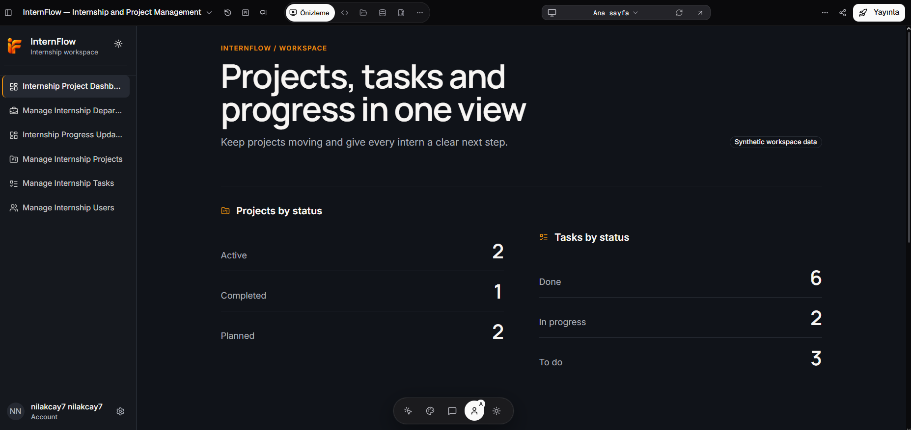
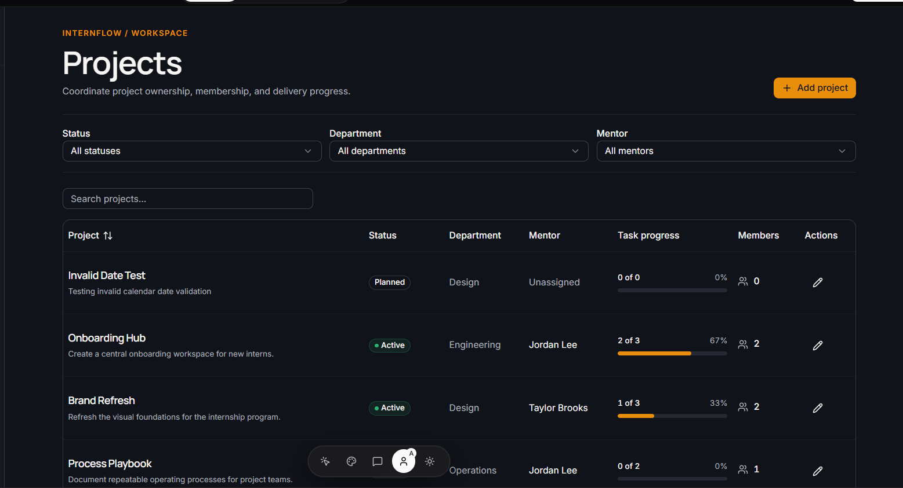
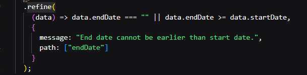
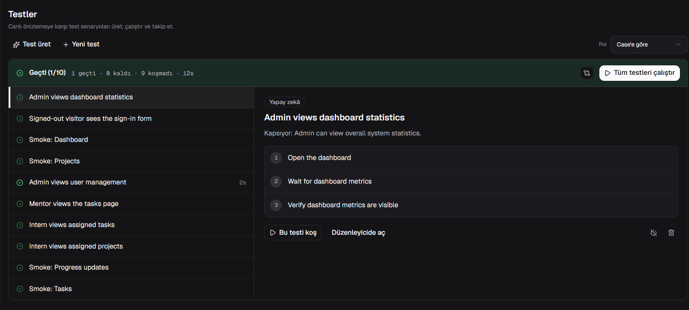

# InternFlow Case Study

InternFlow is a web-based internship and project management application developed and tested during my internship at Kuika Software.

## Project Overview

The application was designed to support internship and project management processes through different user roles.

Main modules include:

- Dashboard
- Department Management
- Project Management
- Task Management
- User Management
- Progress Updates
- Role-based access

## Technologies

- React
- TypeScript
- ASP.NET Core
- REST API
- Relational Database

## My Work

During my internship, I worked on analyzing, testing and improving the application.

My main responsibilities included:

- Functional testing
- Frontend code inspection
- Form validation
- API and network debugging
- Database relationship analysis
- Role-based access testing
- Security testing
- Automated testing
- Deployment testing
- UI and navigation improvements
- Platform comparison and reporting

## Issues and Improvements

### Project Date Validation

The application initially allowed a project end date to be earlier than the start date.

A frontend validation rule was added to prevent invalid date ranges.

### Task Assignment

The task assignment form initially listed users who were not eligible project interns.

The frontend filtering logic was updated so that only appropriate project members were displayed.

### Progress Updates

The progress update form was improved to correctly associate progress records with project interns.

### User and Department Mapping

User department information was reviewed and corrected to ensure that department data was displayed properly.

## Testing and Analysis

During the project, different testing and analysis methods were used:

- Functional testing
- Manual testing
- Automated test scenarios
- Security scans
- Network request analysis
- Database inspection
- API behavior analysis

## Platform Evaluation

During the internship, Kuika Gate was also evaluated alongside other AI-assisted development platforms:

- Lovable
- Replit
- Base44

The comparison focused on areas such as:

- Application development workflow
- Code access
- Database management
- User management
- Testing
- Security
- Deployment
- Integrations

## Internship Context

This repository is a case study documenting the work carried out during my internship.

The original project was developed and tested using Kuika Gate.  
For confidentiality and security reasons, company-related source code, credentials, secrets and internal technical details are not included in this repository.

## Screenshots

### Final Dashboard

The final dashboard provides an overview of project and task status within InternFlow.

### Projects Screen

The Projects screen allows project records to be viewed and filtered by status, department and mentor.

### Frontend Date Validation

A frontend validation rule was added to prevent a project end date from being earlier than the start date.

### Automated Testing

Gate Tester was used to create and run automated test scenarios for different parts of the application.

